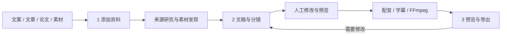

# 视频工坊

**Video Workshop · 可编辑的中文解说视频生成器**

[](LICENSE)
[](https://www.python.org/downloads/)
[](https://github.com/keyu7536-wq/video-workshop/actions/workflows/tests.yml)

把文案、文章、论文 PDF、图片和视频整理成可编辑的解说视频。

视频工坊提供本地浏览器界面：模型负责阅读资料、写稿与安排分镜，语音服务生成配音，FFmpeg 根据真实音频时长合成画面和字幕。支持本机已登录的 Codex CLI，或兼容的图片理解模型 API。它使用已有素材与图表，不是从提示词生成所有新画面的文生视频模型。

当前版本：`0.3.5`。更新记录见 [CHANGELOG](CHANGELOG.md)。源码许可证：[MIT](LICENSE)。第三方依赖、模型和用户素材各自适用的条件见 [第三方说明](THIRD_PARTY_NOTICES.md)。

[快速开始](#安装与打开) · [三步流程](#第一次使用) · [作者项目素材](docs/media-sources.md) · [配置与排错](docs/configuration.md) · [验证与发布](docs/testing.md) · [参与开发](CONTRIBUTING.md)

## 能做什么

- 输入已有文案，或根据文章/论文自动写稿；逐段编辑文字和镜头。
- 深色创作工作台，支持按标题搜索历史作品；桌面与窄屏均可完成三步编辑流程。
- 论文模式查找作者项目、阅读相关源码，使用项目页与仓库中的演示视频、图片，并保存研究笔记、素材清单与引用依据。
- 画面对应讲述内容，支持视频取段、完整动作保留、论文图裁切与高亮。
- 使用可编辑的节点、箭头和阶段，解释步骤、因果与反馈关系；按真实配音的旁白锚点逐步显现和高亮，适用于论文与通用讲解。
- 配置音色、语速、横竖屏、方形或自定义画幅；按实际配音长度生成字幕和时间线。
- 导出 MP4、MOV、WebM、MP3、WAV、SRT、VTT，以及可继续编辑的任务 ZIP。
- 复核文案与实际成片，把问题、资料缺口和检查范围留在项目记录中。

画面标题直接写主题，默认不显示“先讲清：”这类讲述提示，不自动追加配音说明片尾。章节、来源和其他画面设置可以按任务调整。

讲述结构默认自动选择，根据题材、受众和时长平衡必要解释、信息密度和观看节奏。论文涉及的常见方法、问题、改进、机制和效果需要交代清楚，可以合并、调整顺序和轻重，不强制做成五段汇报。普通文章可采用论述、事件或故事结构；已有文案逐字保留。界面也可选择“问题—解决”或“跟随原文结构”，选择会随任务保存，供 Codex 和 API 的资料整理、写稿及审核共用。

`diagram` 镜头把需要解释的关系绘制为分阶段流程示意图，生成配音后再解析阶段时间。是否使用示意图取决于内容，并非所有视频都需要流程框。原始演示、概念示意和实验数据承担各自的用途。结构合法、时间对齐都不能代替内容审核，详细约定见 [故事与画面设计](docs/story-and-visuals.md)。



## 安装与打开

需要 Python **3.11 或更新版本**，建议使用 Python 3.12。首次安装依赖需要联网。

从 [Releases](https://github.com/keyu7536-wq/video-workshop/releases) 下载源码包并解压，或克隆仓库：

```bash
git clone https://github.com/keyu7536-wq/video-workshop.git
cd video-workshop
```

**Windows：** 解压或克隆源码后，双击 `start.cmd`。脚本创建独立的 `.venv`、安装基础依赖并启动浏览器工作台。

**Linux / macOS：** 在项目目录执行：

```bash
bash start.sh
```

默认访问地址是 **http://127.0.0.1:8780**。端口和应用名称可修改，见 [配置说明](docs/configuration.md)。Windows 工作流已经做过本地测试；Linux/macOS 提供启动脚本与手动配置方式，尚未完成同等平台验收。

建议使用独立的 Edge 或 Chrome 浏览器。VS Code 内置预览可能不支持 MP4 的 AAC 音轨，出现有画面但无声音；请把工作台地址复制到独立浏览器打开，详见 [无声预览排查](docs/configuration.md#预览有画面但没有声音)。

升级时，先关闭正在运行的旧服务，再使用新版启动脚本。新版服务支持示意图镜头和随任务保存的讲述结构，旧进程不会自动加载这些能力。

视频合成需要含 `libass` 字幕滤镜的 FFmpeg，以及中文字体。程序优先使用系统 FFmpeg，否则尝试依赖包 `imageio-ffmpeg` 提供的版本。Windows 使用微软雅黑，macOS 使用苹方或黑体，Linux 可安装 Noto CJK 字体；详细排错见配置说明。

模型与语音条件：

- **Codex 模式：** 另行安装 Codex CLI，并使用自己的账户完成登录。源码包不包含登录状态。
- **API 模式：** 在设置中填写服务地址、支持图片和结构化输出的模型，以及自己的 API Key。
- **Edge 配音：** 需要联网，不要求在本程序中填写配音 API Key；上游服务不可用时仍可能失败。
- **可选本地配音：** 需要额外环境、模型和硬件；不随基础安装自动启用。见 [本地配音配置](docs/configuration.md#可选本地配音)。

## 第一次使用

1. **添加资料。** 粘贴文案或文章，添加链接，或上传 PDF、图片、视频；选择内容类型、讲述结构、自适应时长或目标秒数、画幅、音色与语速。文案需要逐字保留时选择已有文案方式。
2. **文稿与分镜。** 默认在这里停下，逐段改稿、换素材、调整裁切和视频起止位置；可以播放所选原视频片段。保存后再点击生成视频。动态图在此显示结构预览，实际动画在配音后生成。
3. **预览与导出。** 播放整片或实际时间线上的单个镜头，查看复查结果；需要修改时返回第二步，保存后重新生成。下载所选格式和发布标题、简介；程序不会自动上传到社交平台。

“直接生成成片”和“允许自动返修”可按任务选择，默认保留人工检查点、关闭自动改稿。已有文案仍逐字保护。目标时长是制作预算，实际片长随录音和完整动作调整。打开旧任务后可以修改原始输入并新建任务，旧任务保留；修改文稿或配音设置后，旧成片不能冒充新版预览。

新任务默认选择自适应时长：按内容重点决定讲解长度，再按真实配音安排画面与字幕。语速独立选择，默认云扬男声、`+50%`，可以在主界面直接调整；设置弹窗与主界面同步。打开已有任务时恢复该任务自己的设置，成片预览显示文件实际使用的音色、语速和时长。本地 Qwen 音色使用独立配音配置，百分比语速选项不可用。

计划审核指出阻断问题时，任务会停在“分镜待修改”。可以直接定位问题段落或打开对应镜头，修改后重新复核；也可以选择“自动修正并生成”。同一输入全流程共用最多 3 次修订生成额度，包含格式修正、分镜修订、时序恢复与成片返修；每轮使用上一轮具体意见，通过复核后再制作。初次正常生成不计入额度，重复点击不重置。审核服务暂时不可用时保留候选，下次只继续审核；修改有效文稿、素材或设置后才按新输入计数。一般建议和来源说明单独列出，不与阻断问题混在一起。

对于条件列、目标数据列和共用坐标轴分散的宽图，可使用“按列拼接图表局部”。程序按同一源图像素比例拼接所选竖条，保留行对齐，接缝明确标示省略区域；不会重绘数据或自动更改画幅。编辑器可修改列区间、查看实际拼接预览；审核同时核对原图与拼接图。它适用于共用行和尺度的图表，不能用来拼接不兼容的实验条件。

如果用途是先筛论文再精读，可使用“论文初筛”要求示例，并填写研究兴趣。程序会围绕主要贡献、必要背景、机制、证据范围和相关局限提供阅读判断依据；不会把不同任务的分数拼成论文排行榜，也不会把通用文章强制改成论文模板。

在自动写稿的文章框粘贴一个或多个独立网址，也会按资料链接读取；已有文案中的网址保持原文。文字版 PDF 支持合计 400 页、200 万提取字符，单文件下载上限 100 MB；长文档分批读取正文，页面图按预算抽样。全文文字读取不代表每张图都已视觉审阅，覆盖记录保存在任务的 `analysis` 目录。扫描件仍需要先 OCR。

| 任务状态 | 含义 |
| --- | --- |
| 待生成 / 文稿已准备 | 文案与分镜已保存，可以编辑或继续渲染 |
| 制作中 | 正在读取资料、调用模型、配音、编码或复核 |
| 已完成 | 当前生成流程已结束；关闭成片复核时，不代表内容审核已经通过 |
| 分镜待修改 / 待复核 | 计划审核未通过时回到第二步修改；已有成片时可查看草稿，处理具体问题或未完成的检查 |
| 失败 / 已停止 | 打开任务查看具体错误及日志，修正条件后重试；已有资料和缓存通常保留 |

完整流程与输出文件解释见 [制作流程](docs/production-workflow.md)。

## 文件存在哪里

新任务保存在 `jobs/<任务编号>/`。常用文件：

```text
jobs/<任务编号>/
├── request.json                 任务设置
├── analysis/studio_plan.json     可编辑文稿与分镜
├── assets/                      本任务素材
├── audio_cache/                 配音与时间信息缓存
├── project.json                 渲染配置
├── narration.txt                讲解稿
├── evidence.json                引文与裁切依据
└── output/
    ├── video.mp4                视频或待复核草稿
    ├── narration.wav            配音
    ├── subtitles.srt            字幕
    └── final_review.json        开启复核时生成的结果
```

论文深读还会生成研究笔记和来源清单。源码发布包不包含已有任务、论文、视频、语音缓存、模型权重、账户或私人演示素材。**不要将自己的 `jobs/`、输出、日志或本地配置提交到公开仓库。** 分享任务 ZIP 前，应另行检查它包含的素材和记录。

## 开发与验证

激活项目虚拟环境后运行：

```bash
python -m pip install -r requirements-dev.txt
python -m playwright install chromium
python -m unittest discover -s tests -p "test_*.py"
python scripts/smoke_render.py
```

离线渲染检查会在临时目录生成测试图案、测试音和短视频，打印路径并验证解码与尺寸。它不调用模型或 TTS，也不是正式配音效果演示。可用 `--output-dir` 指定新的空目录，或用 `--font` 指定字体文件。

生成干净源码包：

```bash
python scripts/build_release.py --check
python scripts/build_release.py --version 0.3.5
```

输出位于 `dist/`，包含源码目录、ZIP、SHA-256 校验文件和逐文件清单。打包器使用明确的文件清单，排除运行数据，并检查部分高置信度敏感信息模式；这不代替人工检查。已有版本不会被覆盖，请换版本号或指定新的输出目录。贡献方式见 [CONTRIBUTING.md](CONTRIBUTING.md)。

## 项目结构

```text
studio/                 浏览器工作台、分镜与预览
studio_server.py         本机服务与任务调度
studio_engine.py         资料、计划、审核与合成流程
studio_research.py       作者项目研究与媒体发现
studio_repository.py     公开仓库读取与版本记录
make_video.py            配音、字幕和 FFmpeg 合成
model_api.py             兼容模型 API 适配
skills/                 共用的制作规范与审核标准
tests/                  隔离回归测试
scripts/                安装、离线渲染检查与源码打包
docs/                   流程、配置、素材及验证说明
```

## 当前边界

- 工作台面向本机使用，尚未提供公网多用户部署需要的认证、配额和权限隔离。
- 网站访问、下载、资料长度和模型调用存在限制；媒体发现记录不等于穷尽检索。
- 自动复核基于抽帧、文本与时间线，不能代替完整观看和听音。Edge 配音并非每次都附带独立 ASR 核对。
- 流程示意图需要正确的节点关系和旁白锚点；示意动画不构成实验测量，也不模拟真实物理运动。修改旁白后需重新生成并检查阶段时序，各画幅的可读性仍需预览。
- 普通重渲染会重做镜头；已有配音缓存，尚未实现完整的按镜头增量渲染。
- 更换模型后仍需验证事实和成片质量，不保证达到某个网页版服务的相同结果。

能力、已知限制和后续方向见 [项目检查与改进清单](docs/project-audit.md)。可复用的论文制作能力位于 [paper-video-director 技能](skills/paper-video-director/SKILL.md)。
