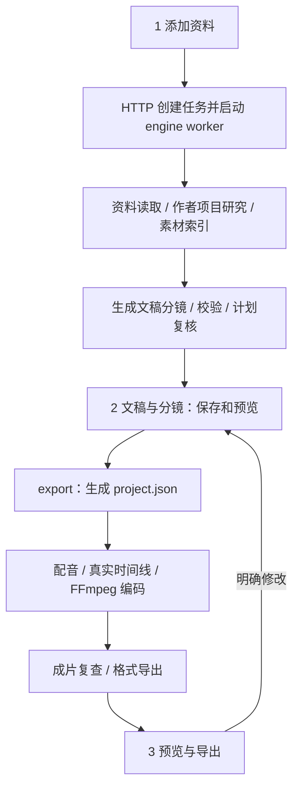

# 架构与代码导航

视频工坊是本机浏览器工作台。Python 宿主程序负责读取资料、保存任务、校验计划、调用语音服务和 FFmpeg；模型根据宿主提供的文字与图片返回结构化结果。它使用已有素材和程序绘制的示意画面，不是生成全部新画面的文生视频模型。

本文说明实际代码的职责和数据流。使用步骤见 [制作流程](production-workflow.md)，开发环境与验证命令见 [验证与发布](testing.md)，贡献约定见 [CONTRIBUTING](../CONTRIBUTING.md)。

## 先从这些入口读起

| 入口 | 职责 |
| --- | --- |
| [start.cmd](../start.cmd)、[start.sh](../start.sh) → [scripts/bootstrap.py](../scripts/bootstrap.py) | 准备基础虚拟环境与依赖，启动工作台。 |
| [studio_server.py](../studio_server.py) | 本机 HTTP 接口、上传、参数校验、任务快照和后台进程调度；默认绑定 `127.0.0.1`。 |
| [studio/app.js](../studio/app.js) | 三步界面的任务加载、表单、保存、轮询与恢复操作；页面结构和样式在 `studio/index.html`、`studio/style.css`。 |
| [studio_engine.py](../studio_engine.py) | 主流程：`collect` 收资料，`prompt_for` 组装规划输入，`validate` 校验，`review_plan` 复核，`export` 转换渲染配置，`execute` 调度各阶段。 |
| [make_video.py](../make_video.py) | 读取 `project.json`，生成配音和真实时间线，渲染镜头、字幕并合成视频。 |

`paper_video.py` 同时保留早期论文命令行入口和共享工具。当前浏览器工作流走 `studio_engine.py`；不要误把旧 `pipeline` 当成工作台主入口。仍被复用的 JSON 保存、视频检查和 Codex 调用位于 [paper_video.py](../paper_video.py)。

## 三步界面怎样落到后端



这张图表示工作台的主要路径，不是要求人工执行每个内部步骤。`auto_render` 可跳过第二步等待；默认先让用户编辑。`Manager` 每个服务进程同时调度一个制作任务，通过独立 Python 子进程运行 `studio_engine.py`，持续收集日志。任务锁、运行编号和进程记录用于避免同一任务被重复修改；这不是分布式任务队列。

| HTTP 操作 | 数据与执行行为 |
| --- | --- |
| `POST /api/upload`、`POST /api/create` | 文件先进入上传暂存区；创建独立任务，保存 `request.json`，启动 `prepare`。读取时复制附件到该任务的 `assets/`。 |
| `POST /api/plan` | 校验并保存编辑后的文稿分镜及创作要求；不直接编码视频。 |
| `POST /api/replan` | 以当前段落旁白作为受保护文稿，重新准备分镜，停留在编辑步骤。 |
| `POST /api/render` | 保存本次画面、配音等设置，校验计划及审核版本，再配音、编码；按配置执行成片复查和导出。 |
| `POST /api/resume` | 继续尚未完成的准备流程；已有有效资料和阅读缓存可以复用。 |
| `POST /api/review` | 仅复核与当前计划、设置一致的现有成片，不重新配音或编码。 |
| `POST /api/export` | 从版本匹配的现有成片导出所选格式，不重新生成全片。 |
| `GET /api/job`、`GET /api/status` | 分别提供任务快照和当前 worker 状态；前端据此显示步骤、问题、文件及可恢复操作。 |

来源文件、视频裁切、图表拼接和逐步放大的预览也由本机接口提供。前端预览不能替代最终编码帧的复核。

## 核心数据边界

同一个任务里有三份作用不同的数据，不应混用：

- **`request.json`：用户意图与设置。** 保存输入、创作要求、模型选择、声音、时长模式和画幅等。`script` 是受保护原稿；模型生成与自动修订必须经过原稿保留校验。用户在编辑器明确改稿时，后端同步相应输入版本。
- **`analysis/studio_plan.json`：可编辑的内容计划。** 用来源 ID 引用资料，组织段落、旁白、证据和镜头，也可包含讲述主线、段落解释安排、流程图或动画。Schema 和主要语义校验在 `studio_engine.py`，专用字段由各模块校验。
- **`project.json`：渲染输入。** `export` 把来源引用解析成实际文件，生成论文裁图、转换裁切与高亮坐标，写入画幅、声音和渲染参数。它是从计划派生的文件；只修改它不会同步编辑器计划或审核记录。

计划中的视频取段长度和图片时长权重，不等于最终镜头时间。`make_video.build` 先拿到真实 PCM 与词时间信息，再解析旁白锚点、保留完整动作并对齐帧边界。实际镜头表写入 `output/rendered_shots.json`。

工作台导出的项目启用严格视频连续性：所选原片不足以覆盖实际讲述窗口时，报告具体时序缺口，交由明确的分镜修订处理；不会偷偷拿同段任意静图接替正在讲的对象。旧独立 `project.json` 的兼容行为由配置决定，不能据此推断新任务的行为。

## 按职责找模块

| 要处理的内容 | 主要模块与边界 |
| --- | --- |
| 输入、PDF 与长资料 | [studio_engine.py](../studio_engine.py) 的 `collect` / `acquire_link`；[studio_documents.py](../studio_documents.py) 提取各页文字和有限页面预览；[studio_context.py](../studio_context.py) 组织有界上下文、分批研究笔记及引文校验。全文文字读取不等于逐页看图。 |
| 作者项目和公共检索 | [studio_research.py](../studio_research.py) 负责身份核对、研究调度、来源清单和缺口；[studio_search.py](../studio_search.py) 提供有来源记录的检索。 |
| 公开仓库 | [studio_repository.py](../studio_repository.py) 提供固定快照、版本记录和有界文件读取；`Research.repo` 选择与论文相关的文件。读取源码不执行作者代码，也不等于复现实验。 |
| 媒体发现与下载 | [studio_media.py](../studio_media.py) 解析项目 HTML、README 与补充材料中的媒体；`Research.download_media` 管理候选、预算和入库；[studio_hosted_media.py](../studio_hosted_media.py) 隔离运行平台解析和有界下载；[studio_network.py](../studio_network.py) 提供有限传输重试和读取工具。访问限制保留为缺口。 |
| 素材去重、覆盖与选片 | [studio_media_catalog.py](../studio_media_catalog.py) 合并相同内容的来源、汇总获取范围；[studio_media_index.py](../studio_media_index.py) 抽样已获取视频、生成候选片段并校验选择理由。发现链接、成功下载、抽帧和实际采用是不同状态。 |
| 讲述与解释规划 | [studio_story.py](../studio_story.py) 管理输入类型和讲述结构；[studio_director.py](../studio_director.py) 管理段落解释安排；[studio_storyboard.py](../studio_storyboard.py) 管理整片主线和理解检查。普通文章不强制套论文结构，填写规划字段不代表已经讲清楚。 |
| 画幅和时长设置 | [studio_display.py](../studio_display.py) 校验画幅并计算有效尺寸；[studio_duration.py](../studio_duration.py) 区分自适应与目标时长。时长模式不擅自改变固定语速或删减原稿。 |
| 裁切与真实构图预览 | [studio_crop.py](../studio_crop.py)、[studio_chart_composition.py](../studio_chart_composition.py)、[studio_video_crop.py](../studio_video_crop.py)、[studio_visual_beats.py](../studio_visual_beats.py) 分别处理论文区域、同尺度列拼接、视频框选与逐步放大；[studio_visual_preview.py](../studio_visual_preview.py) 和 [studio_review_assets.py](../studio_review_assets.py) 生成编辑及计划复核所需的预览。 |
| 示意动画与渲染 | [studio_diagrams.py](../studio_diagrams.py) 绘制分阶段节点关系；[studio_motion.py](../studio_motion.py) 绘制对象状态变化；[studio_render.py](../studio_render.py) 负责布局、字幕、镜头编码与时序缺口诊断。动画锚点在配音后解析。 |
| 配音 | 固定 Edge 配音在 [make_video.py](../make_video.py)；[studio_voice.py](../studio_voice.py) 负责显式开启的自动节奏；[studio_local_voice.py](../studio_local_voice.py) 对接独立本地语音 worker。缓存和时间戳依赖实际文稿及声音参数，不在失败后悄悄换音色。 |
| 审核、版本与交付 | `review_plan` 复核计划；[studio_visual_quality.py](../studio_visual_quality.py) 汇总画面使用与节奏诊断；[studio_delivery.py](../studio_delivery.py) 抽取成片帧、复查和导出；[studio_revision.py](../studio_revision.py) 检查计划、设置与实际文件版本。 |
| 返修与进程基础设施 | [studio_repair_budget.py](../studio_repair_budget.py) 统一计数；[studio_plan_repair.py](../studio_plan_repair.py)、[studio_recovery.py](../studio_recovery.py)、[studio_final_repair.py](../studio_final_repair.py) 分别修订计划、恢复时序和处理成片反馈；[studio_repair_checkpoint.py](../studio_repair_checkpoint.py) 保存回滚点；[studio_process.py](../studio_process.py) 提供任务锁、进程检查与日志。 |

前端按编辑职责拆分：`studio/display.js` 管画幅，`preview.js` 管镜头编辑和布局预览，`director.js` 管段落解释与逐步放大，`storyline.js` 管讲述主线，`motion.js` 管动画编辑，`video-crop.js` 管视频框选。它们由 `app.js` 连接到任务状态和保存接口，不独立决定审核是否通过。

## Codex / API 接口边界

工作台统一调用 `studio_engine.call_ai(prompt, images, analysis, request, schema, suffix)`：

- **Codex 路径：** 交给 `paper_video.call_codex`，使用已登录 CLI、只读沙箱、图片参数与输出 Schema。每次使用独立临时结果，确认本次进程成功且返回 JSON 对象后才替换诊断输出，不能复用上一次结果冒充新调用。
- **API 路径：** 交给 [model_api.py](../model_api.py) 的 `request_json`，使用兼容 Chat Completions 的文本、图片与 JSON 对象输出接口。模型服务必须支持这些能力；接收到 JSON 后，仍由宿主做结构和业务校验。

两条路径使用项目内的 [制作合同](../skills/paper-video-director/references/production.md) 和 [审核规则](../skills/paper-video-director/references/review.md)。提示词要求模型只分析已附资料；联网读取、下载、执行 FFmpeg 和保存任务由宿主控制。项目不会因本机恰好安装某个额外 skill，就声称程序自动调用过它。

界面 API Key 不写入 `request.json` 或浏览器持久化设置，启动 worker 时通过进程环境传递。模型调用可能向所选服务发送正文、摘录和图片；这不是完全离线处理。语音服务与语言模型是两条独立接口，Codex 登录不提供其他语音服务的凭据。

## 审核、返修与恢复

结构校验、模型审核和实际编码检查承担不同责任。结构合法不证明事实正确；计划审核通过不证明渲染后没有字幕遮挡；抽帧审核也不等于完整观看与试听。

**同一有效输入全流程共享最多 3 次修订候选生成。** 格式修正、分镜修订、时序恢复和成片返修共用一个账本，不是每阶段各 3 次。初次正常生成不计数；候选调用前先占用一次，生成失败或校验失败也计数。初始结构校验的兼容修正同样占额度，即使没有开启后续自动返修也可能发生。

`studio_repair_budget` 用来源、有效设置和已知计划版本关联同一输入，避免自动切换候选或重复点击重置计数。用户明确修改有效文稿、来源或配置时，才建立对应的新输入记录。每轮保留反馈、候选及结果；完全相同且已被完整审核拒绝的候选，不通过重复审核碰运气。

审核服务不可用时保留候选和待续审阶段，不生成新稿、不额外消耗修订次数，也不记为通过。恢复入口先处理有效的待续审记录。时序修订继续保护旁白和完整动作；候选失败时按检查点恢复有效产物，而不是用失败候选替代已确认的结果。

计划审核绑定计划、创作要求、有效画幅、时长和规则上下文；成片记录绑定计划与设置，以及 `project.json`、视频文件、实际镜头表的内容摘要。`studio_revision` 读取当前文件内容计算摘要，不能只靠文件名、大小或修改时间判断。保存新稿或更改有效设置后，旧视频仍可存在，但不能作为新版审核或导出的证明。

任务的 `job.json` 保存状态和阶段。常见状态为 `created`、`processing`、`prepared`、`review_needed`、`completed`、`failed`、`cancelled`。计划被明确阻断时停在 `review_needed / plan_review`，不编码；成片复查未完成时可以保留待复核视频。`completed` 表示所选流程结束，尤其关闭成片复查时，不能解释成内容已获质量保证。

## 持久化目录与源码隔离

数据保存在源码根目录下的独立任务目录；不是数据库服务。以下列出常用文件，并非每个任务都会生成全部项目：

```text
jobs/<任务编号>/
├── job.json                       状态、当前阶段、运行编号与错误
├── request.json                   用户输入与非密钥配置
├── assets/                        复制的附件、下载素材和派生裁图
├── analysis/
│   ├── sources.json               来源 ID、文字、文件和出处
│   ├── images.json                提供给模型的预览图清单
│   ├── studio_plan.json           可编辑文稿与分镜
│   ├── research/                  项目读取记录、manifest、媒体发现清单
│   ├── media_index.json           已获取视频的候选片段索引
│   ├── repair_budget.json         当前共享返修计数
│   ├── repair_budgets/            各输入版本的候选、意见和检查点
│   ├── final_frames/              成片抽帧及 coverage.json
│   ├── studio_run.log             worker 日志
│   └── render.log                 渲染子进程日志
├── research.json / research.md    深读笔记（按需）
├── review.json                    当前计划审核
├── project.json                   派生渲染配置
├── narration.txt / evidence.json  文稿与证据
├── publishing.json                发布标题与简介，不会自动发布
├── audio_cache/                   配音和时间信息缓存
└── output/
    ├── work/                      编码中间文件
    ├── video.mp4                  成片或待复核草稿
    ├── narration.wav              实际整片配音
    ├── subtitles.srt              时间对齐字幕
    ├── rendered_shots.json        实际镜头及时间线
    ├── timing_recovery.json       时序诊断
    ├── run_report.json            实际尺寸、时长和声音信息
    ├── render_receipt.json        渲染版本证明
    ├── final_review.json          成片复查结果（按需）
    └── exports.json               附加格式清单（按需）
```

`tmp/studio_uploads/` 是任务创建前的上传暂存区；`app.local.json` 是本机非密钥配置，默认值由 [app_config.py](../app_config.py) 提供。虚拟环境、语音模型、上传素材、任务、日志和 `dist/` 均属于运行或交付数据，不提交到公开源码。

`paper_video.save_json` 通过唯一临时文件和原子替换保存单个 JSON，并对 Windows 短暂文件占用做有界重试；它不是跨多个文件的数据库事务。修改保存或恢复逻辑时，需要同时考虑任务锁、版本证明及失败后的文件组合。

[scripts/build_release.py](../scripts/build_release.py) 使用明确清单构建不含运行数据的源码包；新增运行模块、前端资源、文档或测试时要同步清单。用户导出的任务 ZIP 是另一种产物，包含素材和任务记录，分享前需自行检查内容与使用权限。

## 贡献时怎样选验证范围

优先沿着实际输入到输出的边界做改动，不为整理目录搬动整个调用链。新增配置要一起检查服务端校验、保存与恢复、有效设置、审核失效和前端提交；新增镜头要同时检查 Schema、导出坐标、真实渲染与复核素材。

相关回归集中在 `tests/`：资料和媒体读取、模型边界、返修预算、渲染恢复、版本绑定各有隔离测试；浏览器测试使用本地临时任务；裁切、字幕和时序测试还需核对真实 FFmpeg 输出。入口命令与依赖见 [验证与发布](testing.md)。不把私人论文或历史任务复制进测试，离线模拟通过也不等于外部平台下载或模型内容质量已获验证。
