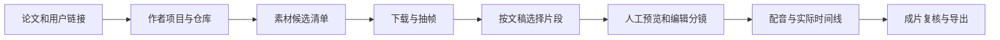

# 作者项目与视频素材

论文 PDF 是一种资料入口。视频工坊也会查找并读取作者项目页、公开代码仓库，以及作者链接的图片和演示视频。

## 怎样提供资料

在第一步添加论文 PDF 或论文链接，开启联网研究和深读。如果已知道作者项目、GitHub 仓库或素材地址，可一并粘贴到资料链接中。明确的作者链接能减少同名项目误匹配。

程序先核对论文题名、作者、任务和项目之间的关系，再建立素材候选清单。仓库 README、许可、目录和相关源码仅作为资料读取；程序不会安装或运行作者代码。

## 素材如何进入成片

| 来源 | 处理方式 |
| --- | --- |
| 论文中的图表 | 提取页面，选择可读的图表区域，并保留坐标轴、图例和条件 |
| 作者网页的图片、视频和 `source` 标签 | 解析明确链接、响应式和懒加载属性，再下载支持的文件 |
| GitHub README 的 Markdown 或 HTML 素材 | 结合文件所在目录解析相对地址，保留原始来源 |
| 无文件扩展名的附件 | 根据明确的媒体线索和服务器实际类型判断；HTML 页面不会作为视频直接使用 |
| 嵌入播放器与补充页面 | 记录候选和访问范围；无法取得受支持原片时保留缺口 |
| 登录、平台限制或不支持的流媒体 | 记录不可访问原因；可改为用户上传获得使用权的本地素材 |

YouTube、Vimeo 等嵌入播放器不等于可直接下载的视频文件。发现链接、下载成功、抽帧和完整观看是不同状态，不能互相替代。程序不绕过登录或平台访问限制。

下载后，视频会取得真实时长和抽帧预览，进入分镜的素材选择。第二步可换素材、设置起点和时长，播放选中的区间；第三步按实际配音后的时间轴查看最终镜头。演示画面用于说明具体行为，实验指标应配对应结果图，不能仅凭一段演示推断成功率。

## 查看覆盖和缺口

每个任务保留这些文件：

| 文件 | 内容 |
| --- | --- |
| `analysis/research/media_inventory.json` | 已发现的候选、来源页面、采用状态和未采用原因 |
| `analysis/research/manifest.json` | 网页与仓库读取记录、媒体统计、下载或解析缺口 |
| `analysis/sources.json` | 真正进入任务的资料和可用素材编号 |
| `research.md` | 研究笔记、已核查范围和需要继续确认的内容 |
| `evidence.json` | 当前文稿与画面的依据 |

为了限制运行时间和资源占用，读取、下载和模型图片数量都有预算。候选过多时会筛选；被预算排除的素材仍留在清单中。具体限制以本任务的 manifest 为准，不代表已搜遍所有视频。

作者媒体各自适用原始许可。项目的 MIT 许可证只覆盖本项目源码，不自动授予论文、演示视频、图片或音乐的转载权。
