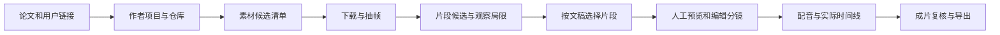

# 作者项目与视频素材

论文 PDF 是一种资料入口。视频工坊也会查找并读取作者项目页、公开代码仓库，以及作者链接的图片和演示视频。

## 怎样提供资料

在第一步添加论文 PDF 或论文链接，开启联网研究和深读。如果已知道作者项目、GitHub 仓库或素材地址，可一并粘贴到资料链接中。明确的作者链接能减少同名项目误匹配。

程序先核对论文题名、作者、任务和项目之间的关系，再建立素材候选清单。仓库 README、许可、目录和相关源码仅作为资料读取；程序不会安装或运行作者代码。

## 素材如何进入成片

| 来源 | 处理方式 |
| --- | --- |
| 论文中的图表 | 提取页面，选择可读的图表区域，并保留坐标轴、图例和条件 |
| 作者网页的图片、视频和 `source` 标签 | 解析明确链接、响应式和懒加载属性，再下载支持的文件 |
| GitHub README 的 Markdown 或 HTML 素材 | 结合文件所在目录解析相对地址，保留原始来源 |
| 无文件扩展名的附件 | 根据明确的媒体线索和服务器实际类型判断；HTML 页面不会作为视频直接使用 |
| 嵌入播放器与补充页面 | 记录候选和访问范围；无法取得受支持原片时保留缺口 |
| 登录、平台限制或不支持的流媒体 | 记录不可访问原因；可改为用户上传获得使用权的本地素材 |

YouTube、Vimeo 单视频链接会尝试获取公开、非直播、非 DRM 的 HTTPS MP4 视频流，最高 720 行、15 分钟、单项 120 MiB；每轮最多 4 次尝试、总共 120 秒。平台只提供分片流、要求登录或验证、超过预算时，保留具体原因，不读取浏览器 Cookie 或安装播放器组件。发现链接、下载成功、抽帧和完整观看是不同状态，不能互相替代。原片音轨不用于解说成片，下载流可能仅含画面。

新任务按实际文件 SHA-256 合并完全相同的图片和视频，保留所有已观察到的来源。同一视频经上传和作者页下载不会增加独立素材数量；不同编码仍可能内容相同，文件哈希不能证明语义上独立。已有分镜的任务不会自动改写素材编号。

GitHub API 限流时，程序先固定公开仓库的 commit，再读取有界目录和最多 9 份小文本，不为读 README 和方法代码下载整个大型仓库。目录不完整、单文件正文截断会记录范围；README 中的 PDF 与相对补充材料链接也进入读取清单。代码始终仅作资料，不安装或执行。

下载后，视频会取得真实时长和抽帧预览，进入分镜的素材选择。第二步可换素材、设置起点和时长，播放选中的区间；第三步按实际配音后的时间轴查看最终镜头。演示画面用于说明具体行为，实验指标应配对应结果图，不能仅凭一段演示推断成功率。

## 片段索引与人工选择

程序对已下载视频建立有限范围的片段索引。它读取当前文件的 SHA-256 哈希，在 `sources.json` 已登记的抽帧时间上重新解码，再把实际图片交给视觉模型。默认每次最多索引 16 个视频，每个视频最多检查 18 个已登记时间点、返回 6 个候选区间，每个候选最长 60 秒。超过预算、没有采样时间或无法解码的素材会保留具体缺口。

每个候选记录素材编号、起止时间、画面描述、用途（行为演示、对比、过程或背景）、实际观察的时间点及局限。观察时间必须来自本次附图，且位于候选区间内。模型只能根据这些采样帧描述可见内容，不能据此保证帧间连续动作完整、动作成功、声音内容或使用许可。索引完成表示这轮有限范围的处理完成，不等于整段原片已完整观看，更不等于适合直接入片。

第二步的镜头编辑器显示这些候选与局限。选择后填写与当前旁白相关的具体原因，播放区间确认动作和条件；手动更改素材、起点或时长会清除原绑定，需重新选择。绑定保存在镜头的 `media_segment_id` 和 `selection_reason` 中，只用于编辑和检查，不写入画面。所选区间须落在候选范围内并覆盖至少一个已观察时间点；满足这些条件仍不能代替相关性判断。未使用索引的旧项目和手动选片继续可用。

缓存同时绑定视频真实字节、采样时间列表、时长和索引策略。即使文件名相同，替换内容后旧片段也不能继续通过保存和导出检查。模型不可用或索引失败时保留缺口，仍可人工挑选素材；不会伪造已完成的观察，也不强制视频占比。

## 裁切与构图预览

视频镜头支持在原片抽帧上选择 `bbox`，再查看真实裁后的画布构图。预览和编码使用同一裁切规则，并应用当前画幅及“完整显示／铺满”设置；“铺满”可能再次居中裁掉边缘。预览只使用所选区间中已登记的采样时间，缺少采样时明确提示，不伪造画面。

“查看裁后画面”显示静态抽帧，不是裁后片段的完整播放，也不含最终字幕。原片区间播放用于检查连续动作，最终视频用于检查实际裁切、字幕与旁白的组合。裁掉多栏拼图的无关面板时，应保留辨认当前对象、条件和对照所需的信息；固定裁切不会追踪移动主体。

## 查看覆盖和缺口

界面在研究笔记外单独显示素材获取结果，区分新获取、重复、失败和未尝试。独立视频数量仅在文件哈希齐全时显示。分镜会检查跨段连续示意图和重复构图；生成前只报告计划结构，成片后使用实际时间线。检查提出建议，选片仍由观点与实际画面是否对应决定，不要求固定的视频比例。

每个任务保留这些文件：

| 文件 | 内容 |
| --- | --- |
| `analysis/research/media_inventory.json` | 已发现的候选、来源页面、采用状态和未采用原因 |
| `analysis/research/manifest.json` | 网页与仓库读取记录、媒体统计、下载或解析缺口 |
| `analysis/sources.json` | 真正进入任务的资料和可用素材编号 |
| `analysis/media_index.json` | 视频候选区间、源文件哈希、实际采样范围、局限和索引缺口 |
| `analysis/media_index/` | 按源文件与策略指纹保存的抽帧、模型响应和索引缓存 |
| `analysis/video_crop_previews/` | 原帧、裁后构图与对应素材、区间、显示设置的记录 |
| `research.md` | 研究笔记、已核查范围和需要继续确认的内容 |
| `evidence.json` | 当前文稿与画面的依据 |

为了限制运行时间和资源占用，读取、下载和模型图片数量都有预算。候选过多时会筛选；被预算排除的素材仍留在清单中。具体限制以本任务的 manifest 为准，不代表已搜遍所有视频。

作者媒体各自适用原始许可。项目的 MIT 许可证只覆盖本项目源码，不自动授予论文、演示视频、图片或音乐的转载权。
